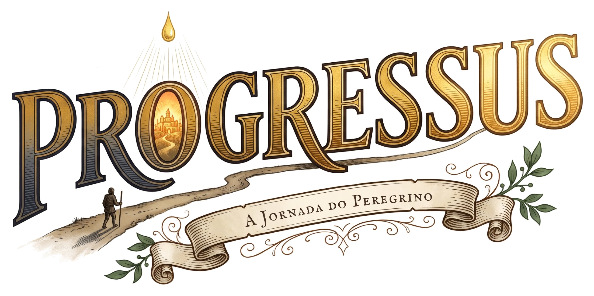

  

# Progressus

**O peregrino sempre chega à Cidade Celestial. A questão é como.**

*Progressus* é um jogo cooperativo de jornada para 1 a 4 jogadores, a partir de 12 anos, baseado em *O Peregrino*, de John Bunyan (1678). Os jogadores não controlam heróis diferentes: cada um cuida de uma faculdade da alma de Cristão (Entendimento, Vontade, Consciência ou Afetos) e, juntos, levam o peregrino da Cidade da Destruição até a Cidade Celestial. A Graça chega pelos meios que Deus ordenou, mas sopra onde quer (Jo 3.8).

Primeiro jogo da [Lucerna Games](https://lucernagames.com). Edições previstas em português, inglês e espanhol.

| | |
|---|---|
| Jogadores | 1–4 (cooperativo e solo) |
| Idade | 12+ |
| Duração | 45–90 min (provisório, em medição nos testes) |
| Complexidade | 2,5–3 de 5 (estimativa) |
| Situação | Protótipo jogável · teste de mesa |

## Conteúdo do repositório

| Pasta | Conteúdo |
|---|---|
| `logos/` | Logo do jogo com faixa em PT, EN e ES (fundo branco e transparente) |
| `imagens/` | Montagens dos componentes e da mesa preparada |
| `registros/` | Textos de cadastro no BoardGameGeek (EN) e na Ludopedia (PT-BR) |
| `manual/` | Livro de regras |
| `pnp/` | Print and Play do protótipo (em breve) |

## Arte provisória

Toda a arte atual é provisória: foi gerada por IA e serve apenas como direção de arte. As ilustrações finais serão feitas por artistas humanos.

## Teste o Progressus

Inscreva-se em [lucernagames.com](https://lucernagames.com) e marque «Quero participar dos testes do Progressus». Comentários e relatos de partidas: [playtest@lucernagames.com](mailto:playtest@lucernagames.com).

## Direitos

© 2026 Lucerna Games. Todos os direitos reservados. Os arquivos deste repositório são públicos para consulta e teste pessoal, mas não podem ser redistribuídos, modificados ou usados comercialmente sem autorização por escrito. O texto de *O Peregrino*, de John Bunyan, é de domínio público.
